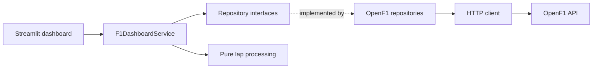

# Arquitetura

O dashboard segue uma arquitetura em camadas com dependencias apontando para o
dominio. Os contratos do dominio nao dependem da API nem do Streamlit.

## Responsabilidades

- `domain/models.py`: modelos Pydantic para os payloads e as projecoes.
- `domain/repositories.py`: contratos independentes de infraestrutura.
- `domain/services.py`: orquestracao de consultas e estatisticas da sessao.
- `processing/lap_processor.py`: filtragem, indexacao e ranking sem I/O.
- `ingestion/`: transporte HTTP e implementacoes concretas dos repositorios.
- `dashboard.py`: composition root e interface Streamlit.
- `utils/`: configuracao de ambiente e logging.

O cliente HTTP repete timeouts e respostas 5xx ate tres tentativas, com espera
exponencial. Respostas 4xx e payloads invalidos sao reportados explicitamente.
Registros individuais que nao correspondem ao modelo sao registrados e
ignorados, preservando os demais dados validos.
